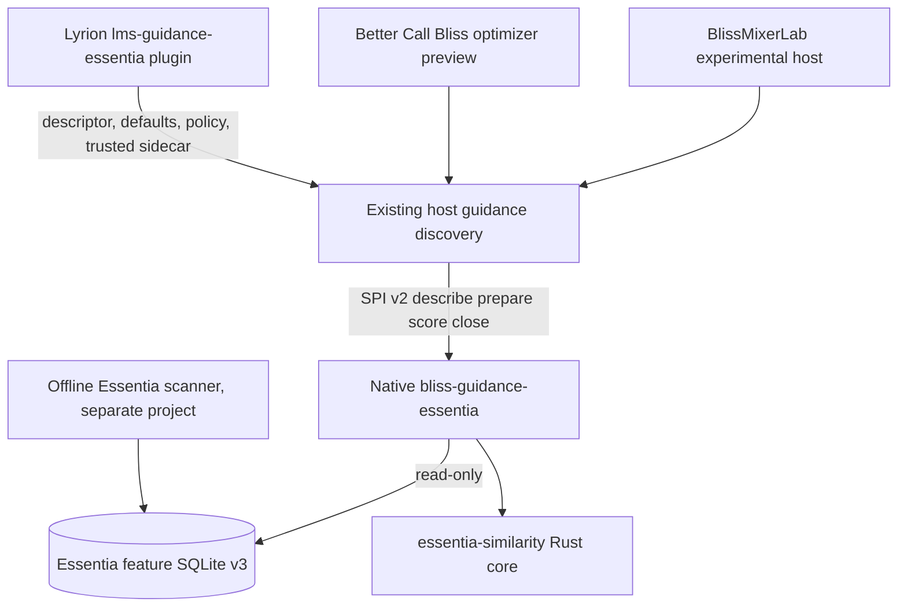

# Lyrion Essentia Guidance: required plugin contract

**Status (30 Oct 2026): Lyrion plugin remains architecture-only — no Plugin.pm, Settings.pm, Perl registration, packaged binary or release. The separate native [bliss-guidance-essentia Draft PR #1](https://github.com/chrober/bliss-guidance-essentia/pull/1) now implements a real research-only SPI v2 JSONL process and SQLite-v3 shadow comparisons with zero active signals. Current Lab SPI candidate metadata (`database_file => undef`) is insufficient for exact sidecar mapping; host resolver/artifact generation remains an explicit prerequisite.**

## Stable dependency boundary

The hosted **native plugin** owns bounded candidate admission and scoring invocation. The **Lyrion provider** owns only settings and metadata, not playlists or the feature model. The Rust **engine** has no Lyrion or Bliss dependencies.

## Implementation target (not yet delivered)

Follow the existing [Guidance Provider Kit](https://github.com/chrober/lms-bliss-guidance-provider-kit) and [Library Signals reference plugin](https://github.com/chrober/lms-guidance-library-signals):

| Future component | Responsibilities |
| --- | --- |
| `EssentiaGuidance/Plugin.pm` | Discoverable plugin identity, truthful descriptor, disabled-by-default availability/status, safe native executable factory |
| `EssentiaGuidance/Settings.pm` | Provider-owned setting defaults, safe source model selection, explicit experimental shadow-only opt-in |
| `EssentiaGuidance/HTML/EN/plugins/EssentiaGuidance/settings/...` | Explain validation, source coverage and exact identity restrictions; no false 'ready' or quality claims |
| `EssentiaGuidance/install.xml` / `strings.txt` | Versioned install metadata, translated labels; do not publish until a functioning implementation exists |
| Native binary | Separate `bliss-guidance-essentia` process, versioned SPI v2 response validator, exact-key read-only source |

Native binary package provenance and individual third-party Essentia/ONNX licenses must be reviewed before distribution. Do not embed third-party audio, ONNX models or personal music metadata in a plugin package.

## Provider-initiated operations prohibited

- Plugin cannot add songs to an admitted candidate shortlist, access arbitrary music directories or mutate `bliss.db`/Essentia SQLite/queue/route.
- Never derive the exact Essentia `track_file` from a candidate's `lms_urlmd5` by assumption, case folding or artist/title matching. An explicit trusted, complete and host-verified identity resolver is required (including Unicode, multiple roots and CUE tracks).
- Never execute locally stored arbitrary CLI commands supplied by a browser; native path and feature sidecar path come from trusted admin/plugin settings, checked and bounded.
- Never claim the current two provisional geometric scores are an independently listening-validated General Metric; genuine reference parity and independent musical evidence remain outstanding.
- Never re-use `learnedblend` as a General-vs-Personal 0–100% slider. Personal learning and calibrated integration are separate optional future work.

## Product rollout gates

1. **Host integration identity contract P1:** exact sidecar key on bounded frozen host candidate pool, verified source fingerprint and no false matches.
2. **Shadow P2:** paired BlissMixerLab DSTM/Similar Tracks comparison with *identical candidates, seeds and eligibility*, no playback or queue change, aggregate-only diagnostics with strict whole-query neutral fallback.
3. **Opt-in A/B P3:** only after actual General Metric selection/quality, model provenance, runtime and licensing gates; existing host continues to own scoring weight and candidate admission.
4. **Better Call Bliss P4:** separately validate *directional transitions and entire route objective*, feasibility and bridge counts. Never interpret symmetric pairwise similarity as proof of a better directed route; apply only on explicit user confirmation.
5. **Feature-first / Hybrid P5:** later, separate host-owned candidate retrieval/admission interface; cannot be implemented by bending the Guidance SPI provider into a library scanner.
6. **Personal P6:** separately fitted and independently calibrated personal scorer with real opt-in, 0–100% influence and full-query fallback, not a reuse of legacy 23D learnedblend.

**CI acceptance once implemented:** correct provider discovery and versioned descriptor, read-only source connection, known absent native binary marked unavailable, host opt-in defaults, host overrides, strict native executable selection, no unauthorized network/DB/queue writes, SPI transcript tests, cross-platform and low-power runtime observations. Nothing in this document is a claim of a working provider.

### Integration status update — executable native provider exists, but is not yet usable by Lyrion

The native provider now implements `describe → prepare → score → close` against the canonical version-pinned SPI crate with a trusted SHA-256-bound exact-key identity artifact and read-only SQLite v3 source. The `essentia_experimental_shadow` channel advertises no active host policy; **all scores return `signals=[]`**, and aggregate-only diagnostics distinguish full evaluated shadow batches from neutral fallback. It is not yet a scored player plugin, and neither BlissMixerLab nor Better Call Bliss currently supplies the required exact identity artifact; `lms_urlmd5` alone is not an exact `feature_tracks.track_file`. The next Lyrion implementation should reference the existing provider kit, make the provider disabled-by-default/unavailable until identities and package exist, and add tests proving no playlist/queue changes. Never mark a provider installed or ready merely because the native Rust binary compiles.
