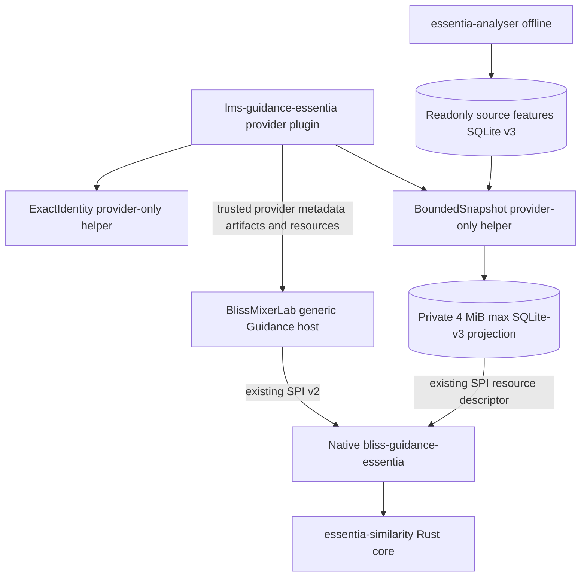

# Provider-owned SPI integration boundary and read-only data proof (31 October 2026)

**Status: experimental helper code on the provider's Draft PR #1.**
A `Plugin.pm`/`Provider.pm` discovery facade exists on this research branch, but
there is **no install manifest, runtime enablement, distributable package,
production native invocation, host connection or playback influence**. The
factory always refuses requests because cross-source provenance is unverified.

## Offline content provenance across multiple roots — 31 October 2026

The provider now has an optional **offline-only** SHA-256 source attestor:

- Reads the existing scanner SQLite-v3 `audio_sha256`, `feature_track_state`
  and validated model fingerprint; hashes the actual full local audio files.
- Accepts distinct music roots only when every chosen track has exactly
  one owning root and no other configured root contains the same
  relative scanner key.
- A separate `verify_audio_content => 1` research mode composes this
  proof into the existing bounded SQLite resource and SHA-256-bound
  native SPI artifact. Full two-root `describe/prepare/score/close`
  integration tests pass against the unchanged Rust binary.
- **Never** interprets matching hashes as an authoritative shared
  Lyrion/Essentia scan generation. Normal provider status remains
  unavailable; full-file hashing is not permitted in a live mixer call.

[Proof, negative tests, CI evidence and remaining requirements]
(audio-content-provenance-20261031.md).
## Architectural contract



The generic host must never import or reference Essentia provider packages,
read Essentia feature databases, construct provider-specific artifacts,
run a separate native process, or understand a provider-specific metric.
All communication with the native program is through the existing
`bliss-playlist-guidance-spi` v2 `describe / prepare / score / close`.
The provider's Lyrion plugin is responsible for its own trusted paths,
feature resources, settings, exact-key mapping and freshness constraints.

## What is now independently implemented and tested

- `EssentiaGuidance/ExactIdentity.pm` preserves the isolated binary
  `TracksV2.File` / `feature_tracks.track_file` equality proof, including
  one host-supplied seed, 2–50 eligible candidates, strict path boundaries,
  and SHA-256-bound `essentia-exact-track-keys-v1` artifact creation.
- `EssentiaGuidance/BoundedSnapshot.pm` opens both source databases with
  `SQLITE_OPEN_READONLY`, pins separate SQLite read transactions and
  projects only 3–51 already verified track rows for exactly one model.
  The private sealed SQLite-v3 result is <=4 MiB, retains Float32LE BLOB
  and exact class order and matches the native SPI resource contract
  `essentia-feature-sqlite-v3` without copying the entire libraries.
- Provider-owned Perl fixtures test CUE, Unicode, missing/duplicate keys,
  source-only reads, per-model fingerprint validation, concurrent WAL
  writer, and whole-cohort rejection.
- The separate `bliss-guidance-essentia` native Draft PR #1 already speaks
  the canonical versioned SPI protocol and advertises no supported active
  host policy; all returned `signals` arrays remain empty.

### Deliberately not migrated

The earlier `EssentiaShadowProbe.pm` started a native binary directly.
That bypasses the existing generic SPI host and was **deleted** from
`lms-blissmixer-lab`, not moved here. Real native calls must use
the existing shared Guidance host `score_batch`, not another transcript
runner inside a provider plugin.

## Mandatory gates before provider registration

1. **Trusted candidate context.** The current generic host envelope
   contains LMS URL and `urlmd5`, but not necessarily the exact analyser
   sidecar key. Neither URL nor hash by itself is an attestation that a
   specific file was decoded. The plugin may use only trusted host-supplied
   track provenance and verifiable scanner identity. A provider cannot
   invent key mappings or populate `database_file` heuristically.
2. **Multiple configured music roots.** The existing proof rejects
   multiple distinct roots. V3 `(track_file, model_id)` cannot distinguish
   two recordings sharing a relative key. Host and analyser must record
   a shared root-qualified source witness, and ambiguous roots must
   fail closed. Do not infer origin from relative paths or case folding.
3. **Joint catalogue generation.** Independent WAL-pinned transactions
   are not an atomic joint Bliss/Essentia generation. Scanner metadata
   must be bound to an authoritative host scan generation and root map,
   with per-track freshness checks; `PRAGMA data_version`, file mtimes
   and matching `TracksV2.File` strings are insufficient.
4. **Native SPI config factory.** A normal provider-kit
   `guidance_provider_*_v1` API facade now exists but always reports
   unavailable and rejects native configuration. Enable the factory
   only after the above trust contracts exist. `prepare.artifacts` must include the
   exact-key artifact and `prepare.resources` only the sealed read-only
   feature projection. The host passes unchanged seed and candidates
   through `anchors`, `context` and `candidates`.
5. **No active scoring.** Native `signals=[]` and empty supported host
   policy persist until model/reference parity, independent musical
   validation, licence, and low-power runtime gates are passed.

## Relationship to Lab Draft PR #3

The initial experimental code under Lab's `Essentia*.pm` names and its
direct native-test workflow have been removed. Lab now contains only
a provider-neutral, disabled-by-default observation helper calling
the existing native SPI callback. It does not yet call a live Essentia
provider. This preserves general-purpose Lab behavior for all providers.

## Minimal verification

```bash
mkdir -p Plugins
ln -s ../EssentiaGuidance Plugins/EssentiaGuidance
prove -lv tests/exact_identity.t tests/exact_identity_sqlite.t tests/bounded_snapshot.t
```

The first native-provider research test in the old Lab branch demonstrated
that the minimal resource format was accepted; the native executable
and its own independent tests remain in `bliss-guidance-essentia`.
No such private provider native tests or binary builds are needed in
the generic Lab host CI.

## 31 October: provider-owned SPI envelope integration verified

`EssentiaGuidance/SpiResourceBundle.pm` now composes the exact-key identity
artifact and the bounded readonly SQLite-v3 projection into ordinary
`prepare.artifacts` / `prepare.resources` plus the canonical flattened
`Anchor` and unchanged global candidate cohort. This helper requires explicit
`research_only=1`, is **not** invoked by the public Provider factory and
cannot attest a common scan generation. A caller must remove its private
temporary directory after the SPI transaction.

The offline fixture in `tests/spi_resource_bundle.t` verifies errors,
resource bounds and identity matching. The new
`tests/spi_resource_native_jsonl.t` exercises the independent Rust native
process through all four canonical SPI-v2 requests using the projected
resource. The native code reports `shadow_evaluated_no_active_signals`, with
zero active guidance signals and no path disclosure. [CI run 41197043974]
(https://github.com/chrober/lms-guidance-essentia/actions/runs/41197043974)
passed 94 isolated Perl checks plus 12 real-process SPI assertions.

The initial test also detected that `Anchor.track` is represented by a
**flattened** candidate in the canonical SPI-v2 JSON envelope; the fixture
was corrected and rerun successfully. No protocol change was required.

**Next gate:** authoritative proof of host catalogue generation, actual
decoded file/source root, and scanner model freshness, including multi-root
collisions. These are not covered by the synthetic SPI success.
