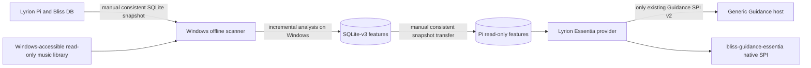

# Windows-first manual analysis and passive Lyrion SPI integration

**Accepted project direction — 31 October 2026:** `essentia-analyser`
runs manually/offline on a Windows machine. It is **not** connected to
library updates, Lyrion rescan notifications, queue creation, or
playlist generation. Analysing 65,000+ files on a Raspberry Pi 4B
could take over a day, so the Windows workstation is the initial
analysis host. The Pi remains the Lyrion host and feature consumer.

## First-phase data flow (no scan-triggered execution)

Do not add any library rescan trigger or automatic analyser launcher
to the Lyrion plugin, BlissMixerLab or native Rust SPI. The analyser
does not need to run on the Pi and the native SPI scorer does not
decode audio or launch inference.

## First integration acceptance criteria

1. **Manual source cohort:** copy the Lyrion Bliss catalogue as a
   consistent SQLite snapshot to Windows; analyze a limited 20–100
   song subset using exactly matching keys and one unambiguous source
   root. Existing `scan-features --bliss-db --db --source-root
   --audio-backend essentia --essentia-worker --workers auto` is the
   scanner path. The scanner writes only its local independent v3
   sidecar. Track provenance is about correct identity, not triggering
   a job from a host scan.
2. **Partial coverage:** progressively extend the sidecar on the
   Windows machine, ideally using one pinned model set and the
   scanner's incremental skip logic. The first SPI trial needs only
   a small bounded seed/candidate cohort with existing vectors.
   Missing feature rows must return neutral; they must **never**
   start a background analysis on the Pi.
3. **Manual transfer:** publish a transactionally consistent copy of
   the Windows feature sidecar to the Pi; the provider reads a
   validated immutable or read-only snapshot. Do not read a raw
   partially copied live WAL file. Document and verify exact model
   IDs, model keys, label order and audio source-key mapping.
4. **Provider-only SPI:** the separate `lms-guidance-essentia`
   preparation path maps selected LMS tracks to exact sidecar keys;
   it creates only bounded, readonly SPI resources and a versioned
   exact-key artifact. The generic host remains unaware of Essentia.
5. **Initially passive:** invoke `describe / prepare / score / close`
   with the already-admitted candidate set, returning `signals=[]`.
   Record coverage and neutral/error reasons independently of
   player or ranking effects. A working synthetic test is not
   a proof that a real Lyrion plugin is installable.

## Trust gates: research versus active ranking

- **Passive, bounded research:** do not demand a full 65k-track
  current catalog match before inspecting an already analyzed
  bounded cohort. Verify each candidate's exact key, one-model
  fingerprint, score vector format and source mapping as far as
  available. Mark any unavailable or potentially stale row as
  missing/neutral and label provenance limitations in diagnostics.
  Never silently call experimental model outputs 'validated'.
- **No live scoring yet:** `Provider.pm` currently reports
  `available=0` and its native factory always rejects calls. This
  remains correct while the real host plugin, source mapping and
  safe offline-sidecar deployment have not been proven. Do not
  bypass this by fabricating a generation token. For research the
  existing `SpiResourceBundle` is explicit offline-fixture code only.
- **Experimental scores:** the scanner currently stores
  `validated_against_essentia=false` unless actual reference parity
  has been established, while the native SPI explicitly recognizes
  `experimental_preview_opt_in` and returns no active signals.
  Provider `SourceProvenance::attest_cohort` presently insists on
  `validated_against_essentia=1`. This mismatch **must be resolved
  explicitly in the research-only path** before real Windows-generated
  unvalidated feature rows can be used for a passive experiment;
  never toggle DB flags or falsely claim model validation.
- **Later active selection:** explicit safety/correctness and
  perceptual metric evidence is needed before using non-neutral
  guidance. An authenticated shared host/scanner generation receipt
  or a reviewed per-track alternative, trustworthy portable music
  root identities and stale-result policy remain future gates for
  active influence. They are **not triggers for the offline scanner**.

## Library updates: deferred scope

`rescan ?`, `rescan done`, `library changed` and `lastscan` may later
inform asynchronous, optional update workflows. None currently
starts an Essentia job, and they are not required for initial
passive research. An updated Lyrion catalog can be handled by
an optional **manual** new Bliss snapshot and later manual Windows
analysis; older feature rows remain usable for read-only research
only where source identity and validity are independently supported.
Full-catalog fingerprints and root-map comparisons are optional
offline research diagnostics, **not** a forced gate for the first
passive integration and not work to run in the live mixer.

## Performance and deployment constraints

- Workstation/NAS I/O and available RAM determine a practical
  fixed or `--workers auto` setting; there is no guaranteed
  completion time. `--workers auto` is one-time sizing, not dynamic
  adaptation. Sample a 100-file cohort before committing to 65k.
- Keep the Windows sidecar and models local and the audio share
  read-only; use a consistent manual snapshot to transfer SQLite
  state. The Pi only needs the separate provider/native SPI runtime
  and feature DB for read-only consumption.
- Original Essentia C++, FFmpeg, third-party ONNX model files and
  Windows DLLs have distinct prerequisites and distribution licences.
  No unaudited public binary bundle is authorized by this plan.

## Deliberately deferred

No automatic rescan hooks, Pi-side 65k processing requirement,
periodic analysis scheduler, model-on-demand service, whole-library
activation, cross-device source-generation epoch or live ranking
influence is implemented in this phase.

Implementation references: [scanner Windows-first runbook]
(https://github.com/chrober/essentia-analyser/blob/feat/scan-audio-stability-guard/docs/windows-manual-offline-scan-first-integration-20261031.md),
[current source provenance](audio-content-provenance-20261031.md),
[separate generation/root design](catalog-generation-and-root-contract-20261031.md).
